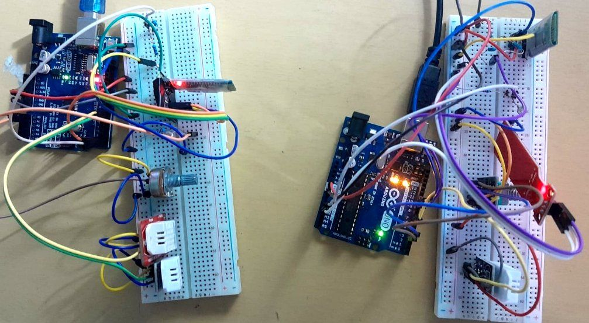
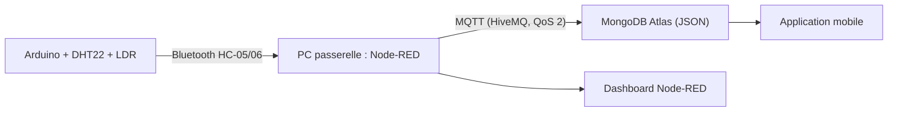
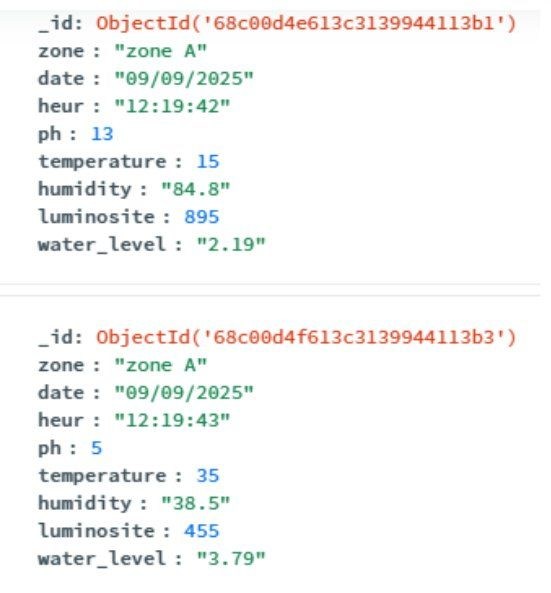
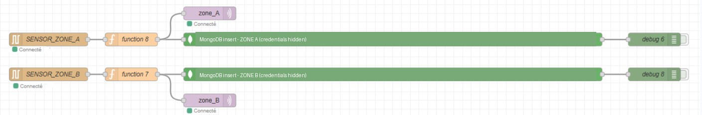
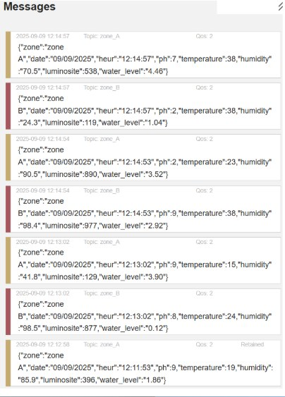

# Système IoT de gestion intelligente des espaces verts

> *End-to-end IoT prototype for smart-city green space monitoring: Arduino sensors → Bluetooth → Node-RED gateway → MQTT (HiveMQ) → MongoDB Atlas → live dashboard.*



## Contexte

Stage technique chez **Harmony Technology** (Rabat), 2025. Objectif : prototyper une plateforme « smart city » de suivi des espaces verts (humidité du sol, température, luminosité) pour remplacer une gestion manuelle par un suivi en temps réel fondé sur les données.

## Chaîne de données



- **Acquisition** : maquettes Arduino avec capteurs DHT22 et LDR, envoi des mesures en Bluetooth (modules HC-05/06 configurés en maître/esclave).
- **Passerelle** : un PC reçoit les données et les traite sous Node-RED (ajout de métadonnées temporelles et spatiales).
- **Transport et stockage** : publication MQTT via le broker HiveMQ (QoS 2), stockage au format JSON dans MongoDB Atlas.
- **Visualisation** : application mobile et dashboard Node-RED en temps réel.







## Résultats et limites

- Chaîne de bout en bout validée, de l'acquisition à la visualisation en temps réel.
- Limite identifiée : la portée du Bluetooth (quelques mètres). L'étude comparative des protocoles désigne **LoRaWAN** pour un déploiement réel, ce qui mène au projet [lorawan-multitech-gateway-study](https://github.com/taha-jorfaoui/lorawan-multitech-gateway-study).

## Contenu du dépôt

```
images/       photos et captures
src/          sketch Arduino, flow Node-RED exporté (à compléter)
docs/         étude comparative des protocoles (à compléter)
```
